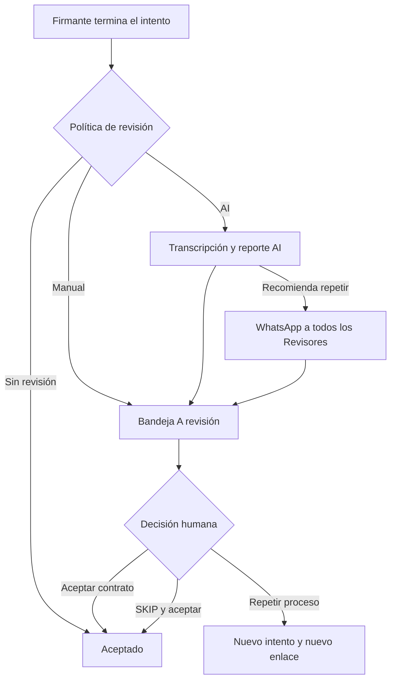
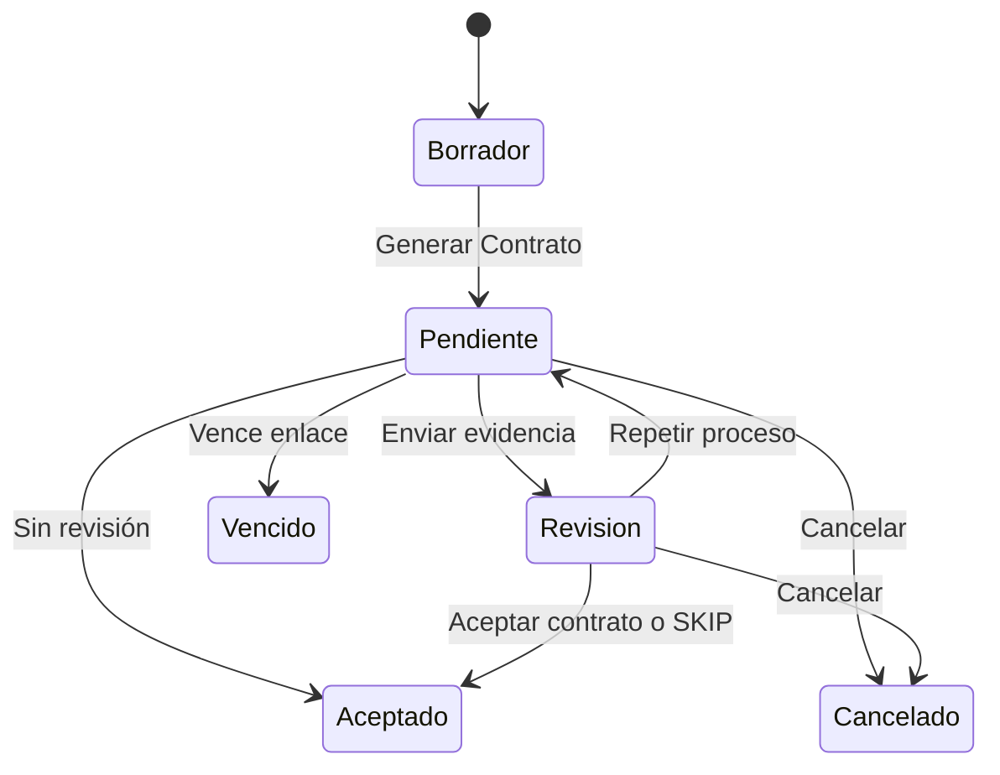
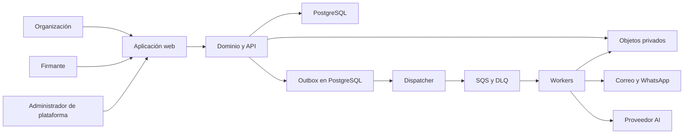

# Arquitectura objetivo de Fides

- **Actualizada:** 8 de agosto de 2026
- **Ámbito:** Etapa 1 POC-Demo local, Etapa 2 POC-Demo remoto y Etapa 3 en AWS
- **Estado:** diseño de producto y sistema; no autoriza contratos o datos reales

## 1. Producto que vamos a construir

Fides es una plataforma contractual administrada para Organizaciones de
cualquier industria. Cuando una Organización entra a la aplicación, sus
Contratos-plantilla, Campos contractuales y Aviso de Privacidad ya están
publicados y listos para operar.

El trabajo previo ocurre fuera de la aplicación:

1. Responsable juridico prepara el contenido jurídico.
2. Publicador de plataforma recibe ese contenido en Markdown y programa los campos necesarios.
3. Publicador de plataforma publica la plantilla y el aviso aplicable.
4. La Organización recibe acceso al portal y comienza a crear Contratos.

La aplicación no redacta, interpreta o aprueba contenido jurídico. La
Organización tampoco edita plantillas, avisos o versiones. La arquitectura
comienza en el cuarto paso.

## 2. Principios no negociables

- Cada dato y archivo pertenece a una Organización.
- Un Contrato emitido es inmutable.
- Cada Contrato conserva la publicación exacta de plantilla y aviso utilizada.
- Sólo Publicador de plataforma publica y versiona contenido jurídico.
- Las versiones son internas; la Organización y el Firmante no las ven.
- El Contrato digital en texto es canónico. El PDF sólo se crea al pedir `Ver PDF`.
- El Firmante entra por un enlace opaco, sin cuenta, correo, teléfono u OTP.
- El Emisor elige la configuración efectiva; la interfaz propone valores predeterminados.
- `Requerir video` y `Requerir INE` aparecen en cada Contrato de todas las Organizaciones y sólo forman parte del recorrido cuando fueron seleccionados.
- La revisión AI recomienda; una persona con rol Revisor decide.
- No existe el estado `Rechazado`.
- `Archivado` y `Eliminado` son clasificaciones operativas, no estados del Contrato.
- La falta de Custodia activa cambia la forma y tiempo de acceso, no elimina el Contrato.
- El producto debe exigir el menor esfuerzo posible a la Organización y al Firmante.

## 3. Actores y alcance

| Actor | Alcance |
|---|---|
| Administrador de plataforma | Opera Organizaciones, capacidades y Archivo Muerto; atiende soporte global |
| Publicador de plataforma como Publicador | Publica y versiona plantillas y avisos; es la única persona con esta capacidad |
| Administrador de Organización | Administra accesos, configuración, asuntos y operaciones reservadas de su Organización |
| Emisor | Crea Borradores, genera Contratos y consulta los asuntos permitidos de su Organización |
| Revisor | Atiende procesos `A revisión` y decide concluir, repetir u omitir |
| Firmante | Revisa, entrega la evidencia configurada y acepta mediante el enlace |
| Agente AI | Transcribe y analiza evidencia, genera un reporte y recomienda; nunca resuelve |

Los roles de Organización son `Administrador`, `Emisor` y `Revisor`. Una Cuenta
individual puede acumularlos. Responsable juridico puede tener acceso global para operar y
dar soporte, pero no publica contenido ni revisa los contratos de las
Organizaciones.

## 4. Superficies del Front-End

### Landing y acceso

La landing debe sentirse como un producto premium y serio, no como un formulario
jurídico genérico. La dirección visual usa carbón, marfil, cobre, tipografía
editorial, fotografía humana multiindustria y movimiento breve. Puede utilizar
las imágenes seleccionadas de `~/Downloads`, después de copiarlas como activos
del proyecto durante la implementación.

La landing tiene sólo:

1. hero con propuesta de valor;
2. ejemplos de industrias;
3. recorrido `Crea`, `Comparte`, `Acepta y conserva`;
4. muestra del producto;
5. cierre de contacto.

Las acciones actuales son `Iniciar sesión` y `Contactar`. No hay precios,
registro público, testimonios inventados o botón de demo.

El login pide correo y contraseña. En el POC-Demo local ninguna cuenta continúa
a TOTP, porque la siembra no fija secretos; una cuenta global que se dé de alta
en `/plataforma/cuenta` vuelve a recorrer el segundo paso. Recuperar contraseña
usa un enlace temporal de un solo uso.

### Portal de la Organización

La navegación se compone según los roles de la cuenta:

- `Contratos`
- `Crear contrato`
- `A revisión`
- `Recientes`
- `Archivados`
- `Eliminados`
- `Accesos`
- `Configuración`

No existe un dashboard de gráficas previo. Al entrar se muestra directamente la
lista de Contratos, una sección compacta de Alertas y el `Buscador de Contratos`,
con páginas de 20 resultados. La búsqueda empieza sólo con texto y revela los
filtros secundarios después de encontrar coincidencias. En escritorio se usa
tabla; en móvil, tarjetas legibles.

### Administración de plataforma

La superficie global incluye:

- Organizaciones y capacidades contratadas;
- editor simple de Contratos-plantilla;
- editor simple del Aviso de Privacidad;
- historial privado de publicaciones;
- soporte y diagnóstico de Contratos;
- Archivo Muerto agrupado y buscable por Organización.

### Recorrido del Firmante

El Firmante ve una superficie móvil sin navegación comercial:

```text
Organización · Referencia
Contrato ─ Evidencia ─ Aceptar
```

La etapa `Evidencia` conserva el lugar en el progreso, pero sólo muestra las
pantallas que correspondan a ese Contrato.

## 5. Acceso de la Organización

Cada Organización tiene exactamente un Administrador principal y hasta diez
Accesos de Organización activos, incluido el principal.

- El Administrador puede preparar y enviar cualquier número de invitaciones.
- Cada invitación dura 30 días y tiene correo y uno o más roles.
- Una invitación no reserva lugar.
- Las activaciones ocupan los diez lugares por orden efectivo de finalización.
- Si no hay lugar, la invitación sigue vigente y la persona puede reintentar.
- El correo no se corrige en el mismo registro: se elimina y se crea otro.
- Eliminar un acceso no principal lo revoca, libera su lugar y borra el registro
  administrativo; no existe historial de membresía ni reactivación.
- Los Contratos ya creados conservan sus propios hechos históricos sin depender
  de que la cuenta siga activa.
- El Administrador principal sólo puede eliminarse después de transferir su
  condición a otro Administrador activo.
- Una Cuenta individual con varias Organizaciones elige con cuál trabajar y
  puede cambiarla sin cerrar sesión.

Toda consulta y mutación comprueba en servidor la Organización activa y sus
roles. Nunca se confía en un `organization_id` enviado por el navegador como
única autorización.

## 6. Publicación y versionamiento

### Contrato-plantilla

Publicador de plataforma trabaja en un editor de texto simple con:

```text
| Versión actual | Versión nueva |
| 1.0            | [          ]  |
```

Reglas:

1. la primera publicación es `1.0`;
2. Publicador de plataforma escribe manualmente la siguiente etiqueta;
3. si repite la etiqueta actual, la interfaz pregunta si es correcto;
4. confirmar crea otra publicación inmutable con la misma etiqueta;
5. publicar marca un solo registro como vigente y conserva los anteriores;
6. un marcador sin Campo contractual programado bloquea la publicación;
7. cambiar campos requiere programarlos antes de publicar el Markdown que los usa;
8. los Contratos anteriores nunca cambian.

Una Organización no ve editor, historial, etiquetas o selector de versión. Al
crear un Contrato siempre se usa la publicación vigente. Si un Contrato vence y
se crea otro, el nuevo usa la publicación vigente en ese momento.

### Aviso de Privacidad

El Aviso de Privacidad se publica con la misma mecánica de versión manual. Cada
Contrato conserva el aviso exacto vigente al emitirse. Si falta un aviso vigente,
el recorrido del Firmante falla cerrado antes de recopilar evidencia o aceptación.

## 7. Crear un Contrato

El Front-End utiliza dos pasos.

### Paso 1: Capturar datos

- Si existe una sola plantilla, se selecciona automáticamente.
- Si existen varias, el Emisor elige una.
- El Emisor selecciona Titular contractual y Firmante mediante campos simples;
  si falta alguno, lo da de alta en una pantalla dedicada y regresa al Borrador.
- El Firmante siempre es persona física. Cuando el Titular también lo sea, una
  casilla explícita permite indicar que esa misma persona aceptará y deshabilita
  la selección redundante; una persona moral siempre requiere elegir Firmante.
- La interfaz presenta únicamente los Campos contractuales programados.
- Los campos de texto predictivo muestran sugerencias conforme se escribe, pero
  conservan texto libre cuando una ciudad, aeropuerto o tipo de carga no existe
  en el catálogo.
- El Borrador se guarda automáticamente.
- Una advertencia dinámica aparece sólo mientras falten datos obligatorios y
  enumera exactamente cuáles son.
- `Requerir INE` y `Requerir video` permanecen visibles en cada Borrador y se
  guardan al seleccionarse; las dos opciones existen para toda Organización.
- Vigencia, Política de revisión y Carpeta permanecen en un control secundario.
- `Recientes` permite iniciar el mismo paso con datos operativos compatibles de
  un Contrato anterior; los `Favoritos` personales aparecen primero y también
  están disponibles como atajo al comenzar `Crear contrato`.

### Paso 2: Revisar y generar

La pantalla muestra el Contrato completo en texto, partes, monto y configuración
efectiva. No exige PDF o aprobación intermedia. `Generar Contrato` crea
atómicamente:

- Contrato emitido inmutable;
- Referencia contractual;
- Instantánea de las partes;
- publicación exacta de plantilla y aviso;
- configuración efectiva;
- primer Intento de aceptación;
- enlace opaco con vigencia;
- hashes y evento de emisión.

El resultado ofrece únicamente `Copiar enlace`. La plataforma no abre WhatsApp,
correo o una pantalla de distribución.

## 8. Recorrido del Firmante

### Contrato

1. mostrar el Aviso de Privacidad;
2. mostrar el Contrato completo como texto;
3. ofrecer `Ver PDF` bajo demanda;
4. exigir scroll hasta el final para habilitar `Continuar`;
5. registrar el scroll como interacción técnica, nunca como prueba de lectura.

### Evidencia

El Perfil de evidencia siempre incluye la aceptación y puede añadir:

- INE;
- video guiado;
- ambos.

Cada evidencia aparece en una pantalla sencilla. INE solicita únicamente una
fotografía del frente y otra del reverso. El video abre la cámara con una cuenta
regresiva `3 · 2 · 1`; difumina la previsualización selfie y superpone la
declaración breve aprobada para ese Contrato, por ejemplo con nombre,
Organización, monto y servicio ya formados. La redacción exacta la proporciona
Responsable juridico y Publicador de plataforma la publica. El difuminado no altera el archivo original
privado. Sin Revisión por AI, la plataforma no transcribe o valida la grabación
ni autentica la INE.

### Aceptar

La última pantalla presenta la Leyenda de aceptación aprobada, una casilla y
`Aceptar contrato`. La operación es idempotente y vuelve a comprobar enlace,
vigencia, Contrato e Intento.

- `Sin revisión`: el Contrato pasa a `Aceptado` y el Firmante ve referencia y
  `Ver PDF`.
- `Revisión manual` o `Revisión por AI`: el Contrato pasa a `A revisión` y el
  Firmante sólo ve que la Organización lo contactará si necesita repetir.

No se crea una cuenta, bandeja o seguimiento para el Firmante.

## 9. Revisión y repetición



Reglas:

- Cualquier persona de la Organización con rol Revisor puede decidir.
- El agente AI transcribe el video, analiza la evidencia y adjunta un reporte.
- El agente AI nunca acepta, cancela o crea otro Intento por sí solo.
- Si recomienda repetir, alerta por WhatsApp a todos los Revisores.
- `Aceptar contrato` usa la evidencia actual.
- `SKIP y aceptar` queda documentado como decisión distinta.
- `Aceptar contrato` y `SKIP` no exigen comentario, motivo, casilla o segunda
  confirmación. `Repetir proceso` pide un motivo breve de una lista cerrada y
  sólo exige texto cuando el Revisor elige `Otro`.
- `Repetir proceso` cierra el Intento, conserva el historial y genera un enlace
  nuevo sobre el mismo Contrato inmutable.
- La Organización contacta al Firmante fuera de la plataforma para pedirle que
  use el enlace nuevo; puede copiar un mensaje sugerido y registrar después el
  contacto de forma opcional.
- No existe el estado `Rechazado` y Responsable juridico o equipo juridico no participan en esta revisión.

## 10. Estados y clasificaciones



Estados visibles:

- `Borrador`
- `Pendiente de aceptación`
- `A revisión`
- `Aceptado`
- `Vencido`
- `Cancelado`

Un Contrato vencido o cancelado no se edita ni reactiva. `Crear nuevo a partir
de este` produce un Borrador distinto sobre la plantilla vigente, con referencia,
enlace e Intentos nuevos al emitirse.

Las clasificaciones `Contratos`, `Archivados` y `Eliminados` son independientes:

- `Archivar` es reversible y no cambia el estado.
- `Eliminar` no tiene periodo de 30 días ni restauración dentro de la plataforma.
- Si se elimina un Contrato abierto, primero queda `Cancelado` y se invalida su enlace.
- Sin Custodia activa, el paquete ya está en Archivo Muerto y sólo cambia la metadata.
- Con Custodia activa, el paquete se mueve inmediatamente a Archivo Muerto.
- La sección `Eliminados` conserva metadata buscable y no ofrece recuperación
  autoservicio.

## 11. Buscar, organizar y descargar

`Contratos`, `Archivados` y `Eliminados` usan páginas de 20 y búsqueda limitada a
la Organización activa. La búsqueda general cubre:

- Referencia;
- Contrato-plantilla;
- Titular contractual;
- Firmante;
- Campos contractuales marcados como buscables.

Después de una coincidencia, la interfaz revela filtros por:

- Estatus;
- fechas;
- Carpeta;
- Contrato-plantilla.

Las Carpetas son opcionales y se presentan como carpetas que se pueden abrir.
`Nueva carpeta` es una acción secundaria que sólo solicita su nombre. Archivar
o mover de carpeta nunca cambia el Contrato, su enlace o su custodia.

El PDF se genera únicamente al solicitar `Ver PDF`:

- antes de aceptar representa el Contrato emitido;
- después de aceptar añade el comprobante correspondiente;
- nunca contiene el token o enlace;
- no se genera de forma preventiva al emitir.

## 12. Custodia y Archivo Muerto

Cada Contrato cerrado produce un ZIP inmutable con el Contrato y los artefactos
relevantes que deban conservarse juntos. Incluye manifiesto y hashes. El medio de
intentos mandados a repetir no se incorpora como evidencia final; el historial
sí registra que existieron.

### Sin Custodia activa

- El ZIP canónico vive directamente en S3 Glacier Deep Archive, dentro de
  Archivo Muerto.
- La Organización ve que el Contrato está resguardado.
- No existe botón de recuperación o exportación masiva.
- Un Administrador solicita la recuperación por correo, mensaje o WhatsApp fuera
  de la plataforma.
- El Proveedor puede tardar hasta siete días hábiles.
- Al terminar, el ZIP aparece temporalmente junto a los archivos del Contrato.
- Sólo un Administrador activo de la Organización puede descargarlo.

### Con Custodia activa

- Los archivos cerrados permanecen en acceso inmediato durante el primer año.
- Al cumplir un año desde el cierre, todos pasan a Archivo Muerto.
- Un Administrador puede descargar archivos recientes y pedir exportación masiva.
- Un ZIP histórico se prepara con un compromiso máximo de 48 horas.
- La exportación masiva entrega un ZIP contenedor con un ZIP completo por Contrato,
  sin CSV adicional.
- Sólo Administradores activos pueden descargar archivos preparados.

Las copias de recuperación y exportación son temporales; el ZIP canónico nunca
sale de Archivo Muerto. Los plazos de 48 horas y siete días hábiles son
compromisos del Proveedor, no garantías de AWS.

El Administrador de plataforma puede buscar Archivo Muerto por Organización,
ver metadata y solicitar la recuperación técnica de un paquete. Esa operación
no se expone como ticket, bandeja o flujo de la Organización.

## 13. Modelo lógico mínimo

| Grupo | Registros principales |
|---|---|
| Organizaciones | `organizations`, `commercial_entitlements` |
| Acceso | `accounts`, `organization_members`, `member_invitations`, `sessions` |
| Contenido | `contract_templates`, `contract_template_versions`, `contract_field_definitions`, `privacy_notice_versions` |
| Datos reutilizables de partes | `counterparties` |
| Contratos | `contract_drafts`, `contracts`, `contract_parties`, `contract_links`, `contract_events` |
| Evidencia | `acceptance_attempts`, `evidence_items`, `ai_review_reports` |
| Revisión | `review_tasks`, `review_decisions` |
| Organización | `contract_folders`, `contract_favorites`, `organization_settings`, clasificación y metadata de búsqueda |
| Objetos | `contract_objects`, `cold_contract_packages`, `recovery_jobs`, `export_jobs` |
| Operación | `audit_entries`, `notification_outbox`, `legal_holds`, `retention_policies` |

PostgreSQL es la fuente de verdad para identidad, relaciones, estados, permisos,
metadata y hashes. El almacenamiento de objetos conserva medios y paquetes; el
bucket nunca reconstruye por sí solo un Expediente.

Los nombres son objetivos de dominio, no autorización para editar migraciones
históricas. La implementación deberá crear migraciones nuevas y reproducibles.

## 14. Componentes



El servidor concentra autorización, transiciones, hashes, versionamiento y
URLs temporales. El cliente no recibe secretos, rutas privadas o información de
otra Organización. PostgreSQL conserva el outbox y estado canónico. El
dispatcher publica en SQS un mensaje mínimo con el UUID del trabajo; workers,
reintentos, DLQ y redrive ejecutan notificaciones, análisis AI, empaquetado,
exportaciones y recuperaciones de forma idempotente.

Las capacidades actuales conservan estas fronteras y no introducen servicios
adicionales por sí mismas:

| Capacidad | Estado canónico | Ejecución asíncrona u objetos | Correspondencia en AWS |
|---|---|---|---|
| Buscador, `Recientes` y `Favoritos` | Consultas, índices y preferencias por Cuenta en PostgreSQL | Ninguna | RDS PostgreSQL; no requiere Redis u OpenSearch en 3A |
| Campos con sugerencias | Tipo y opciones versionadas en `contract_field_definitions`; la entrada sigue siendo texto libre | Ninguna consulta a mapas, aeropuertos o geocodificación externa | RDS PostgreSQL y la misma aplicación; no requiere otro proveedor |
| Alertas dentro del portal | `contract_events` y preferencias de la Organización en PostgreSQL | Correo y WhatsApp se escriben en outbox y salen por worker sólo si están configurados | RDS para eventos/outbox, SQS/DLQ y workers Fargate hacia proveedores aprobados |
| INE y video universales | Perfil efectivo, metadata, tamaños y hashes en PostgreSQL | Bytes originales privados mediante el adaptador de objetos; el difuminado del video sólo existe en la previsualización del navegador | Los mismos tres buckets S3 y las mismas rutas de KMS/IAM; no se crea un bucket por evidencia |
| Catálogo del POC-Demo | Semilla sintética reproducible | No se promueve como información real ni como dimensionamiento de Production | Sólo puede poblar Non-production con datos sintéticos; Production comienza vacía y controlada |

El volumen o latencia medidos en 3B podrán justificar caché, réplicas de lectura
o un índice de búsqueda separado. No se incorporan preventivamente y nunca
indexarán cláusulas, INE, video u otra evidencia sensible.

## 15. Etapas y ubicación de los servicios

Fides conserva las mismas fronteras lógicas en las tres etapas. Cambia dónde
vive cada componente y qué garantías operativas lo rodean; el dominio no se
reescribe al promover el producto.

| Capacidad | Etapa 1 · POC-Demo local (actual) | Etapa 2 · POC-Demo remoto | Etapa 3A · Piloto real en AWS | Etapa 3B · Producción escalable en AWS |
|---|---|---|---|---|
| Web y API | Contenedor `app` en la computadora de Publicador de plataforma | Mismo contenedor en un host remoto reemplazable; única entrada pública por HTTPS | ECS Fargate privado detrás de un ALB público | Mismo servicio con autoescalado y capacidad medida |
| Trabajo asíncrono | Contenedor `worker`, separado de `app` | Mismo proceso `worker`, privado en el host | Servicio ECS Fargate privado e independiente | Mismo servicio, escalado por profundidad y antigüedad de cola |
| Estado canónico | PostgreSQL 17 en volumen local, incluidos alertas, `Recientes` y `Favoritos` | PostgreSQL privado en volumen del host; base reconstruible | RDS PostgreSQL Multi-AZ en Production | Mismo RDS, escalado y operado según carga real |
| Búsqueda y sugerencias | Índices PostgreSQL y opciones sembradas en los Campos contractuales | Mismo comportamiento, sin proveedor externo | RDS PostgreSQL; sin OpenSearch, Redis o geocodificación en 3A | Se añade otra tecnología sólo si las métricas lo justifican |
| Cola | ElasticMQ con cola, DLQ y redrive | ElasticMQ privado y reconstruible | SQS y DLQ | Mismas colas con capacidad, alarmas y redrive operativos |
| Objetos | Volumen privado mediante el adaptador de objetos | Volumen privado del host; sólo datos sintéticos | Tres buckets S3 privados: acceso inmediato, Archivo Muerto y temporales | Mismos tres buckets, con políticas y capacidad ajustadas |
| Mensajes y alertas | Eventos, outbox y captura local de correo y WhatsApp | Mismo outbox con captura sintética privada; no entrega a personas reales | RDS, SQS/DLQ y proveedores reales desde workers autorizados | Mismos proveedores con límites y monitoreo operativos |
| AI | Doble local controlado | Doble controlado privado | Proveedor aprobado invocado por workers | Mismo límite; AI recomienda y nunca decide |
| Acceso, secretos e identidad técnica | Contraseña pública sintética; la siembra no exige TOTP, aunque conserva la capacidad | Credenciales revocables propias del entorno; nunca reutiliza las locales publicadas | Autenticación reforzada y auditoría global obligatorias; Secrets Manager, KMS e IAM por cuenta y servicio | Mismos controles con rotación y operación endurecida |
| Red | Puertos locales de desarrollo | Sólo HTTPS web expuesto; base, cola, worker, objetos y dobles en red privada del host | ALB público; workloads privados; RDS aislado; S3 Gateway Endpoint; un NAT Gateway | Misma frontera, con NAT Gateway por zona y redundancia sostenible |
| Resiliencia | Volúmenes locales; sin garantía de disponibilidad | Entorno desechable y resembrable; sin HA ni recuperación contractual | Multi-AZ para RDS, pero sin backups automáticos de PostgreSQL según ADR-0046 | Backups y redundancia adicionales sólo al cumplir sus gates económicos y operativos |
| Datos permitidos | Exclusivamente sintéticos | Exclusivamente sintéticos | Reales sólo en Production y después de cerrar todos los gates | Reales bajo los mismos controles de Production |

### Etapa 1 · POC-Demo local — etapa actual

Docker Compose ya levanta `app`, `worker`, PostgreSQL, ElasticMQ, objetos
privados, captura de mensajes y doble AI. Las migraciones y la semilla crean seis
Organizaciones, 19 Cuentas y un catálogo multiindustria exclusivamente sintético
con roles combinables y recorridos representativos.

Todo el sistema vive localmente. Esta etapa ya es el POC-Demo funcional que
Publicador de plataforma puede presentar desde su computadora; no es una maqueta ni una fase
previa a construir otro producto de demostración.

No se sustituye lógica de producto por pantallas falsas. Sólo las integraciones
externas utilizan dobles locales. La pila arrancada y las pruebas automatizadas
son evidencia técnica, pero Publicador de plataforma todavía debe recorrer y validar los roles,
flujos, estados y capacidades antes de promover el proyecto.

### Etapa 2 · POC-Demo remoto

Después de esa validación, el mismo artefacto se despliega en un solo host remoto
de free tier o costo mínimo mediante Docker Compose o una disposición
equivalente. El host se puede destruir y reconstruir desde migraciones y semilla.
Sólo la aplicación recibe tráfico público por HTTPS; ninguna dependencia publica
su puerto a Internet.

Esta etapa permite compartir el mismo POC-Demo sin depender de la computadora
local, pero no representa AWS, alta disponibilidad, durabilidad contractual o
seguridad de Production. El proveedor concreto se selecciona al preparar la
publicación remota y debe poder reemplazarse sin cambiar el dominio ni los
adaptadores.

### Etapa 3 · Operación real en AWS

AWS Non-production inicia la preparación de la Etapa 3 y reproduce la topología
de Production a menor capacidad con datos sintéticos. Allí se valida la
infraestructura como código y el artefacto exacto antes de promoverlo.

Production en AWS México Central utiliza ALB, ECS Fargate, RDS, SQS, S3, KMS,
IAM y auditoría. La subetapa 3A admite los primeros datos reales sólo después de
cerrar [`REAL-PILOT-GATES.md`](../requirements/REAL-PILOT-GATES.md). La 3B escala
los mismos componentes y añade redundancia sostenible; no introduce otra
plataforma ni una reimplementación.

La captura simplificada, `Recientes`, favoritos, alertas, sugerencias y evidencia
universal no agregan microservicios o productos administrados a esta topología.
Amplían las tablas, índices, eventos, trabajos y objetos que los componentes ya
poseen.

## 16. Orden de promoción

1. Mantener el proyecto en Etapa 1 mientras se prueba la pila local completa.
2. Ejecutar las verificaciones automatizadas y la validación manual de Publicador de plataforma.
3. Corregir cualquier recorrido, autorización, estado o capacidad que falle y
   repetir ambas validaciones.
4. Declarar la Etapa 1 validada de forma explícita; no inferirlo sólo de CI.
5. Preparar la publicación remota, elegir el host reemplazable y desplegar allí
   el mismo POC-Demo como Etapa 2.
6. Validar por HTTPS la demo completa con datos y credenciales exclusivamente
   sintéticos.
7. Aprobar presupuesto e infraestructura como código; desplegar y comprobar AWS
   Non-production como preparación de la Etapa 3.
8. Promover el mismo artefacto a AWS Production únicamente después de cerrar
   todos los gates para el Piloto real.
9. Evolucionar de 3A a 3B cuando carga, clientes e ingresos justifiquen los
   controles adicionales definidos en los ADR aceptados.

## 17. Criterios de terminación de la Etapa 1

- Todas las cuentas sintéticas pueden entrar y sólo ven su alcance.
- Se prueba el límite de diez accesos, invitación de 30 días y activación por orden.
- Publicador de plataforma publica plantilla y aviso `1.0`, una versión distinta y una repetida.
- La Organización nunca ve datos de versionamiento.
- Un Emisor crea con valores predeterminados y también personaliza todas las opciones.
- Cada Organización puede emitir sin evidencia adicional, con INE, con video y
  con ambos; el Firmante completa exactamente el Perfil efectivo.
- El scroll forzado se repite en cada Intento.
- `Ver PDF` es bajo demanda y nunca expone el enlace.
- Funcionan Sin revisión, Revisión manual y Revisión por AI.
- El Revisor puede concluir, repetir y usar `SKIP`; el historial permanece coherente.
- Vencimiento crea otro Contrato desde la plantilla vigente; repetición conserva el mismo Contrato.
- Búsqueda progresiva, sugerencias con texto libre, `Recientes`, `Favoritos`,
  Alertas, páginas de 20, Carpetas, Archivados y Eliminados funcionan y permanecen
  aislados por Organización y Cuenta cuando corresponde.
- La custodia simula correctamente acceso inmediato, Archivo Muerto, recuperación y ZIP completo.
- Exportación masiva sólo existe con Custodia activa.
- El diseño responde en escritorio y móvil con la dirección visual aprobada.
- No hay mensajes externos, secretos, contratos reales o evidencia personal en Git.
- Las pruebas de aislamiento, idempotencia, concurrencia y autorización son negativas y positivas.

## 18. Fuera de la Etapa 1

- acceso público o remoto al POC-Demo;
- Mercado Pago y cobro autoservicio;
- más de un Firmante por Contrato;
- edición de plantillas por la Organización;
- revisión jurídica dentro de la aplicación;
- recuperación autoservicio sin Custodia activa;
- registro público, SSO o acceso social;
- WebAuthn y validación oficial de identidad;
- uso de datos reales antes de cerrar los gates.
